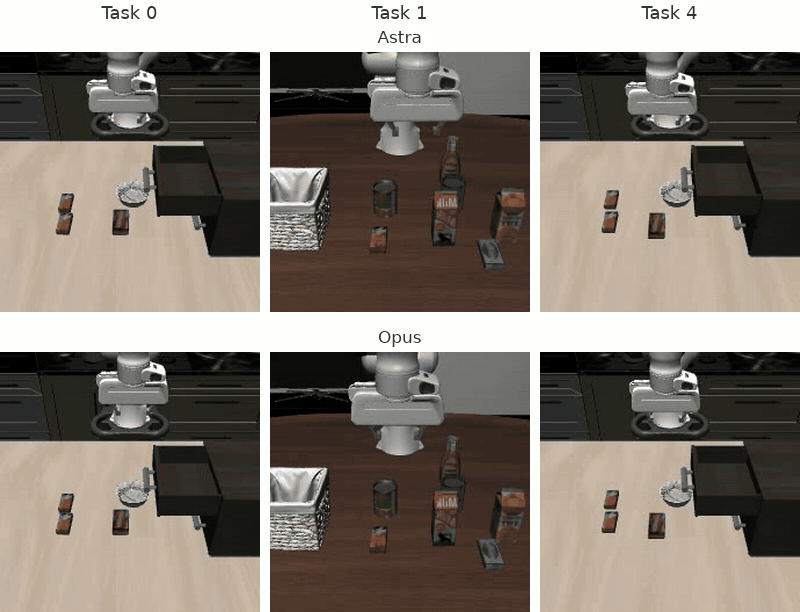
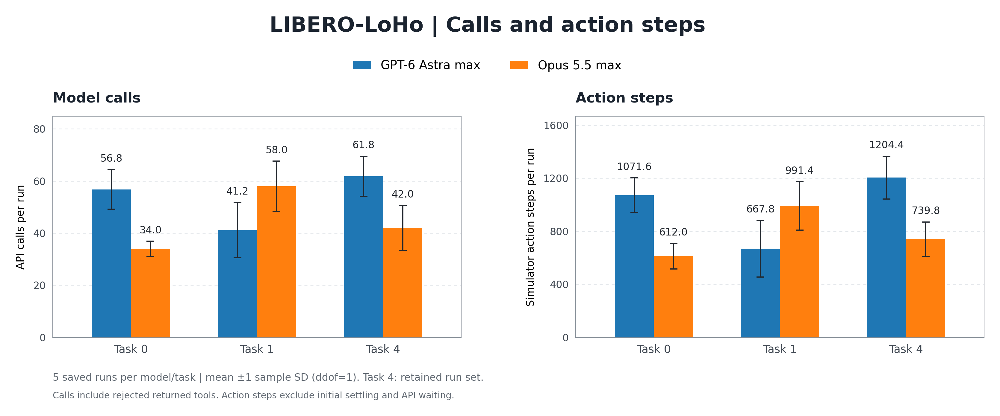

# LIBERO-LoHo: Astra vs Opus robot control

We compare GPT-6 Astra and Claude Opus 5.5 on [LIBERO-LoHo](https://github.com/markli1hoshipu/LIBERO-LOHO), a long-horizon robotic manipulation benchmark, to assess whether frontier models can control a simulated robot and plan and execute sequential tasks zero-shot, without task demonstrations or robot-policy training. Across five saved episodes per model on Tasks 0, 1, and 4, Astra matched Opus's full-task success rate and achieved equal or higher mean goal completion while using approximately 88% fewer output tokens overall. Astra's estimated API cost was 42% lower ($3.91 vs Opus's $6.75 mean per run), and its wall-clock time was 57% shorter (14.8 vs Opus's 34.2 minutes mean per run).

See [setup.md](setup.md) to install the dependencies and reproduce the evaluation runs.

## Setup

- **Benchmark:** LIBERO-LoHo, a long-horizon manipulation benchmark derived from LIBERO.
- **Coverage:** Tasks **0, 1, and 4**, with **5 saved episodes per model per task**—30 episodes total.
- **Models:** GPT-6 Astra **max** and Claude Opus 5.5 **max**.
- **Prompts:** Same task-specific system prompt and motion-tool definitions for both models.
- **Visual inputs:** Static and wrist cameras, **224 × 224 RGB** per view; no depth.
- **Proprioception:** Joint positions/velocities, end-effector pose, and gripper state.
- **Actions:** Absolute **6-DoF end-effector targets plus gripper control**, executed at **10 Hz** with a **25% speed limit**.
- **Context:** Full conversation, images, and tool-result history within each episode.
- **Limits:** **80 API calls**, **2,000 action steps**, and **128,000 output tokens per request**; no spending cap.
- **Scoring:** Native simulator goal predicates; full success requires every final condition.
- **Reporting:** Mean ± sample standard deviation across the five saved episodes per model/task.

### Sample control loop

Both models receive the [same control instructions](prompts/pose-tools-v1_task0_max.txt), task, camera images and robot state, then return one motion-tool call with a short explanation.

For Task 0, an example model response is a `move_to` call with these arguments:

```json
{
  "targets": {"x": 0.14, "y": 0.26, "z": 1.12, "gripper": 1.0},
  "note": "Move above the front butter with open fingers before descending."
}
```

Targets are absolute positions in metres; gripper `1` opens and `0` closes. After execution, fresh images and measured feedback guide the next call until success, a stop call or a limit. The simulator determines the score.

## Findings

### Task comparison video

**Tasks 0, 1 and 4** appear left to right, with **Astra above Opus**, at **4× simulation speed**; API waiting is omitted. Examples are successful runs closest to each cohort's median wall-clock duration. Select the preview for the MP4.

**Wrist camera view omitted from this video, but used in evaluation.**

| Task | Objective |
|---|---|
| **0** | Put the front butter and chocolate pudding into the cabinet’s top drawer, then close it. |
| **1** | Pick up the alphabet soup, butter, and tomato sauce, in that order, and place each into the basket. |
| **4** | Put the back butter and chocolate pudding into the top drawer, close it, and place the black bowl on top of the cabinet. |

<a href="loho-study/videos/astra_opus_tasks_0_1_4_static_grid_4x.mp4?raw=true"></a>

## Results

Overall comparisons use the mean across **15 saved episodes per model**. Figures show the five episodes per model/task, with whiskers indicating **±1 sample standard deviation**. [Exact statistics](loho-study/plots/comparison_statistics.json).

### Astra matched task success and achieved equal or higher goal completion

Both models fully completed **13 of 15 episodes (86.7%)**: 5/5 on Tasks 0 and 4, and 3/5 on Task 1. Mean goal completion was **100% for both** on Tasks 0 and 4, and **86.7% for Astra vs 80.0% for Opus** on Task 1—a **6.7 percentage-point** difference.


### Astra’s estimated API cost was 42% lower

Estimated API cost averaged **$3.91 for Astra vs $6.75 for Opus per episode**, a **42.0% reduction**. Astra cost less on all three tasks, with the largest gap on Task 1 (**$2.89 vs $8.81**).


Bars show total input plus output tokens on the left axis; diamonds show estimated USD cost on the right. Both use mean ± sample standard deviation across five episodes per model/task.

### Astra’s wall-clock time was 57% shorter

Measured wall-clock time averaged **14.8 minutes for Astra vs 34.2 minutes for Opus per episode**, a **56.8% reduction**. API requests, including network/provider waiting, accounted for most elapsed time: **12.9 vs 32.7 minutes** on average.


### Opus used fewer model calls and action steps on average

Opus averaged **44.7 model calls and 781 action steps per episode**, compared with Astra’s **53.3 calls and 981 steps**—**16.1% fewer calls and 20.4% fewer steps**. Task 1 reversed this pattern: Astra averaged **41.2 calls and 667.8 steps**, versus Opus’s **58.0 calls and 991.4 steps**.


