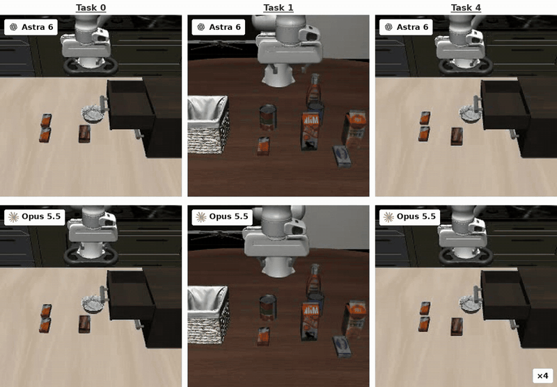
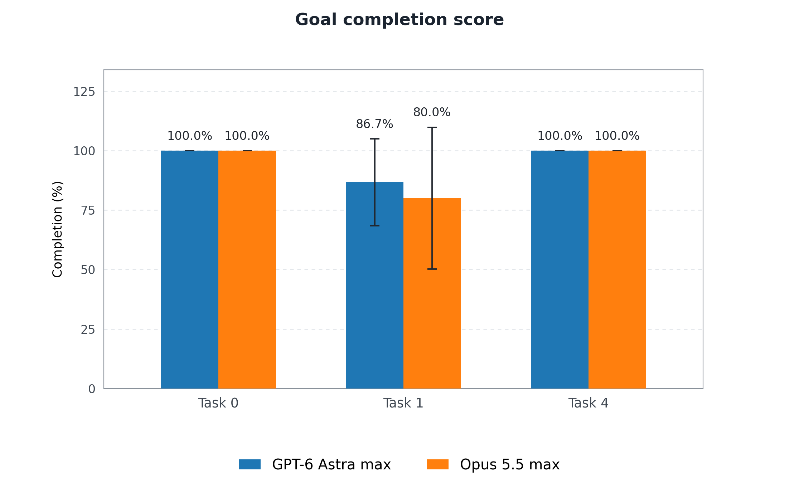
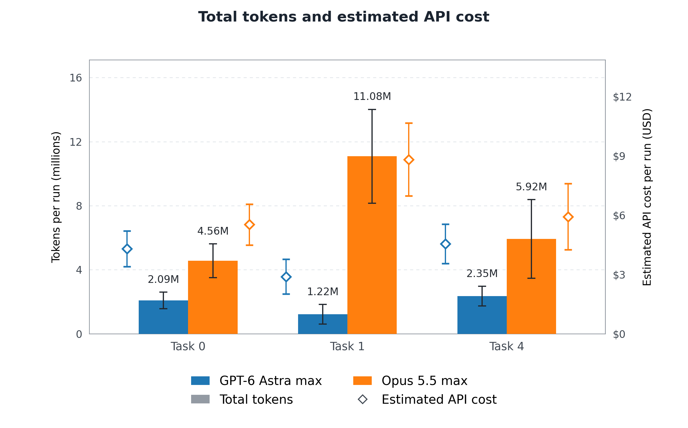
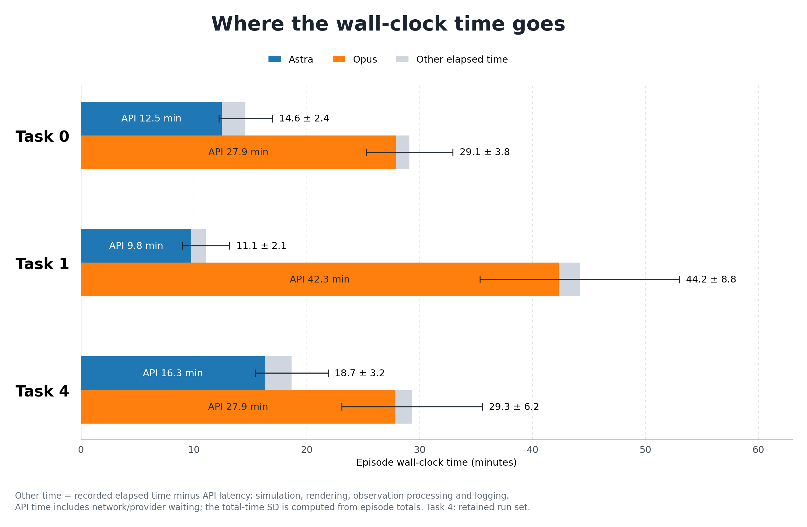

# LIBERO-LoHo: Astra vs Opus robot control

We compare GPT-6 Astra and Claude Opus 5.5 on [LIBERO-LoHo](https://github.com/markli1hoshipu/LIBERO-LOHO), a long-horizon robotic manipulation benchmark, to assess whether frontier models can control a simulated robot and plan and execute sequential tasks zero-shot, without task demonstrations or robot-policy training. Across five saved episodes per model on Tasks 0, 1, and 4, Astra matched Opus's full-task success rate and achieved equal or higher mean goal completion while using approximately 88% fewer output tokens overall. Astra's estimated API cost was 42% lower ($3.91 vs Opus's $6.75 mean per run), and its wall-clock time was 57% shorter (14.8 vs Opus's 34.2 minutes mean per run).

Reproduce the runs: [setup.md](docs/setup.md).

## Findings

### Task comparison video

**Tasks 0, 1 and 4** appear left to right, with **Astra above Opus**, at **4× simulation speed**; API waiting is omitted. Examples are successful runs closest to each cohort's median wall-clock duration. Select the preview for the MP4.

| Task | Objective |
|---|---|
| **0** | Put the front butter and chocolate pudding into the cabinet’s top drawer, then close it. |
| **1** | Pick up the alphabet soup, butter, and tomato sauce, in that order, and place each into the basket. |
| **4** | Put the back butter and chocolate pudding into the top drawer, close it, and place the black bowl on top of the cabinet. |

<a href="loho-study/videos/astra6_opus55_tasks_0_1_4_static_minimal_4x.mp4?raw=true"></a>

**Wrist camera view omitted from this video, but used in evaluation.** API request time is omitted from the video for demonstration purposes.

## Results

Overall comparisons use the mean across **15 saved episodes per model**. Figures show the five episodes per model/task, with whiskers indicating **±1 sample standard deviation**.

### Astra matched task success and achieved equal or higher goal completion

Both models fully completed **13 of 15 episodes (86.7%)**: **5/5 on each of Tasks 0 and 4**, and **3/5 on Task 1**. In the two incomplete Task 1 episodes, Astra completed **2/3 sub-tasks (66.7%) in each**. Opus completed **1/3 sub-tasks (33.3%) in one** and **2/3 (66.7%) in the other**.



### Astra’s estimated API cost was 42% lower

Estimated API cost averaged **$3.91 for Astra vs $6.75 for Opus per episode**, a **42.0% reduction**. Astra cost less on all three tasks, with the largest gap on Task 1 (**$2.89 vs $8.81**).



Bars show total input plus output tokens on the left axis; diamonds show estimated USD cost on the right. Both use mean ± sample standard deviation across five episodes per model/task.

### Astra’s API request time was 61% shorter

Measured API request time averaged **12.9 minutes for Astra vs 32.7 minutes for Opus per episode**, a **60.7% reduction**.



### Opus used fewer model calls and action steps on average

Opus averaged **44.7 model calls and 781 action steps per episode**, compared with Astra’s **53.3 calls and 981 steps**. Opus used **16.1% fewer calls and 20.4% fewer steps**. Task 1 reversed this pattern: Astra averaged **41.2 calls and 667.8 steps**, versus Opus’s **58.0 calls and 991.4 steps**.

| Task | Astra calls | Opus calls | Astra action steps | Opus action steps |
|---|---:|---:|---:|---:|
| 0 | 56.8 ± 7.7 | **34.0** ± 2.9 | 1,071.6 ± 131.3 | **612.0** ± 96.9 |
| 1 | **41.2** ± 10.6 | 58.0 ± 9.7 | **667.8** ± 213.5 | 991.4 ± 182.7 |
| 4 | 61.8 ± 7.7 | **42.0** ± 8.7 | 1,204.4 ± 161.5 | **739.8** ± 130.3 |

## Setup

- **Benchmark:** LIBERO-LoHo, a long-horizon manipulation benchmark derived from LIBERO.
- **Coverage:** Tasks **0, 1, and 4**, with **5 saved episodes per model per task**, for **30 episodes total**.
- **Models:** GPT-6 Astra **max** and Claude Opus 5.5 **max**.
- **Prompts:** Same task-specific system prompt and motion-tool definitions for both models.
- **Visual inputs:** Static and wrist cameras, **224 × 224 RGB** per view; no depth.
- **Proprioception:** Joint positions/velocities, end-effector pose, and gripper state.
- **Actions:** Absolute **6-DoF end-effector targets plus gripper control**, executed at **10 Hz** with a **25% speed limit**.
- **Context:** Full conversation, images, and tool-result history within each episode.
- **Limits:** **80 API calls**, **2,000 action steps**, and **128,000 output tokens per request**; no spending cap.
- **Scoring:** Native simulator goal predicates; full success requires every final condition.
- **Reporting:** Mean ± sample standard deviation across the five saved episodes per model/task.

### Sample control loop

Both models receive the [same control instructions](prompts/pose-tools-v1_task0_max.txt), task, camera images and robot state, then return one motion-tool call with a short explanation.

This recorded Astra `move_to` call from [Task 0, trial 1](<loho-study/task 0/astra_task0_max_nocost_trial1_task0_uncapped_20261011_203025/conversation.json>) specifies all six pose coordinates plus the gripper:

```json
{
  "targets": {
    "x": -0.005,
    "y": 0.005,
    "z": 1.19,
    "roll": 0.0,
    "pitch": 0.0,
    "yaw": 0.0,
    "gripper": 0.0
  },
  "note": "Both the butter and pudding are now visibly resting inside the drawer. I am moving the empty, closed gripper in front of the top-drawer handle to push the drawer shut."
}
```

XYZ targets are absolute world positions in metres; roll, pitch and yaw are in radians relative to the episode's starting orientation. Gripper `1` opens and `0` closes. Omitted pose fields hold their measured values. After execution, fresh images and measured feedback guide the next call until success, a stop call or a limit. The simulator determines the score.
