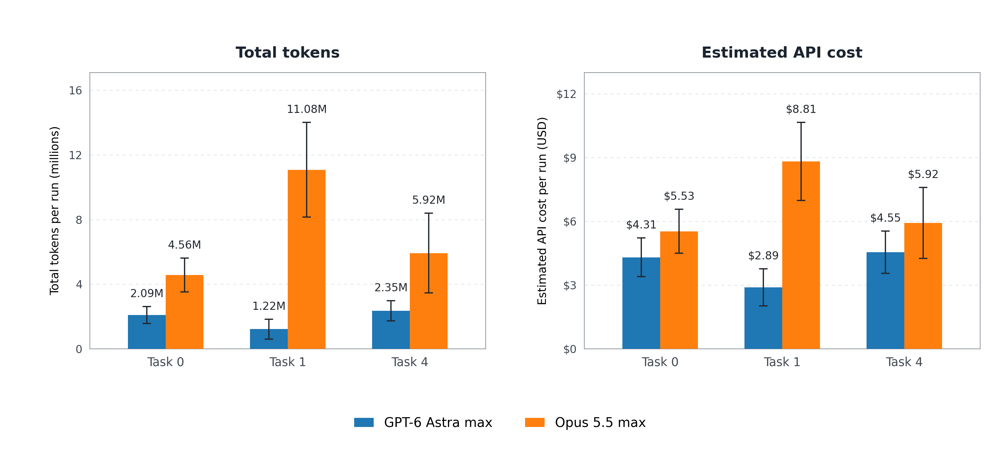
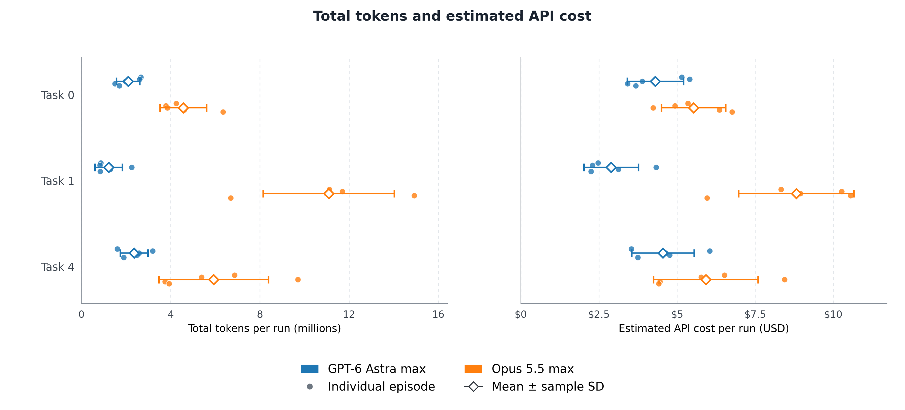
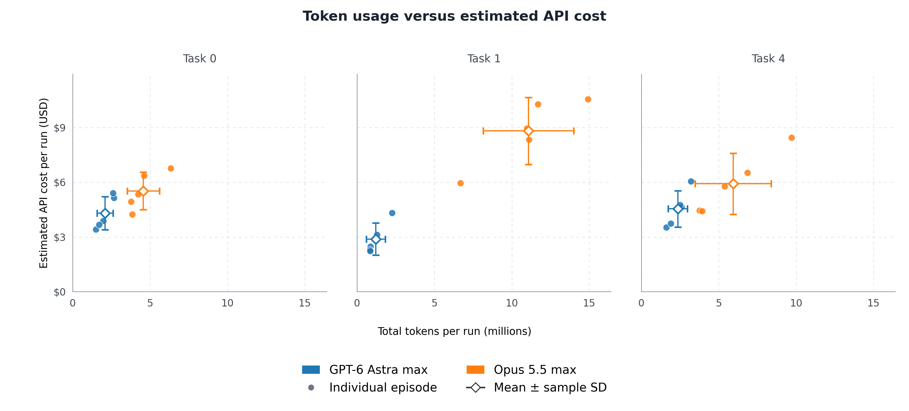

# Tokens and cost alternatives

## Two-panel bar chart

Tokens and estimated cost use separate panels with matching task groups and one shared model legend. Bars show mean values across five episodes per model/task; whiskers show sample SD. Labels give the mean token counts and USD costs.

## Dot plot

Compare the models separately on token volume and estimated cost. Small dots show each episode; white diamonds and whiskers show mean ± sample SD across five episodes per model/task.

## Scatter plot

Each dot plots one episode's total token usage against estimated cost. Tasks share the same axis scales. White diamonds show cohort means, with separate sample-SD whiskers along each axis.

Total tokens are input plus output, including reported reasoning and cache usage. These are token volumes, not output tokens alone. [Recorded values and source hashes](sources.json).

Each figure also has PDF and SVG exports with the same filename stem. Rebuild from the repository root with `wsl -d Ubuntu-24.04 --exec /root/projects/LIBERO-LOHO/.venv/bin/python scripts/plot_tokens_cost_alternatives.py`.
